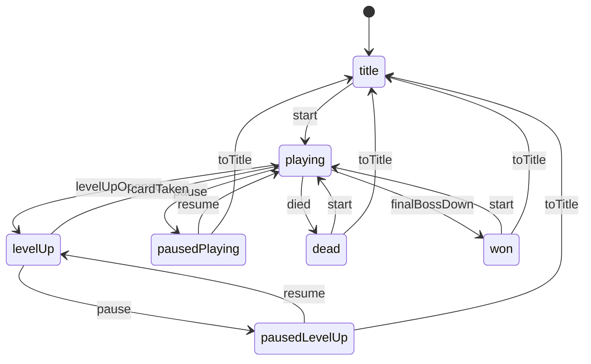

# Run loop

This is the statechart for one run of Agent Arena. The table it is drawn from is `RUN_LOOP` in `src/sim/arena/run-loop.ts`, and the sim can change `status` only through it. A test fails if this diagram and the table disagree.

## What the model check proves

`src/sim/arena/run-loop-model.ts` is a small model of a run: the phase, the world the run started at (the main menu can start a run at any world you have unlocked), how many bosses are down, whether a boss is out, pending level-ups, and the rerolls and skips left. It also covers what can happen on a tick: gaining a level, running out of cards, a boss arriving or falling, dying, and pausing. `run-loop.test.ts` explores every reachable model state, breadth first, and checks that:

- the model never needs a move the statechart forbids
- every reachable state has a next move (no dead ends)
- from every reachable state the run can still end (nothing traps you, such as a level-up that never closes)
- a win needs every boss beaten
- a run can start at every world, and each of those runs can still be won
- inside a run, the boss count rises one at a time, and only when an active boss falls (no boss can be skipped); starting a run sets it to the world you start at
- a paused run can quit to the title (the main menu)
- a finished run is left only by starting over or going to the title
- pausing resumes to exactly where it paused
- every transition in the table is used (none is dead weight)

The same file also plays real seeded runs with the bot. It checks that every status change is an edge in the statechart, that a finished run stays finished, and that the boss count matches the bosses that actually fell.

The first bug it caught: if the final boss fell on the same tick as a lethal hit, the win turned into a death. The sim now changes status only through the statechart, and the statechart has no edge out of `won` except starting over or going to the title.
